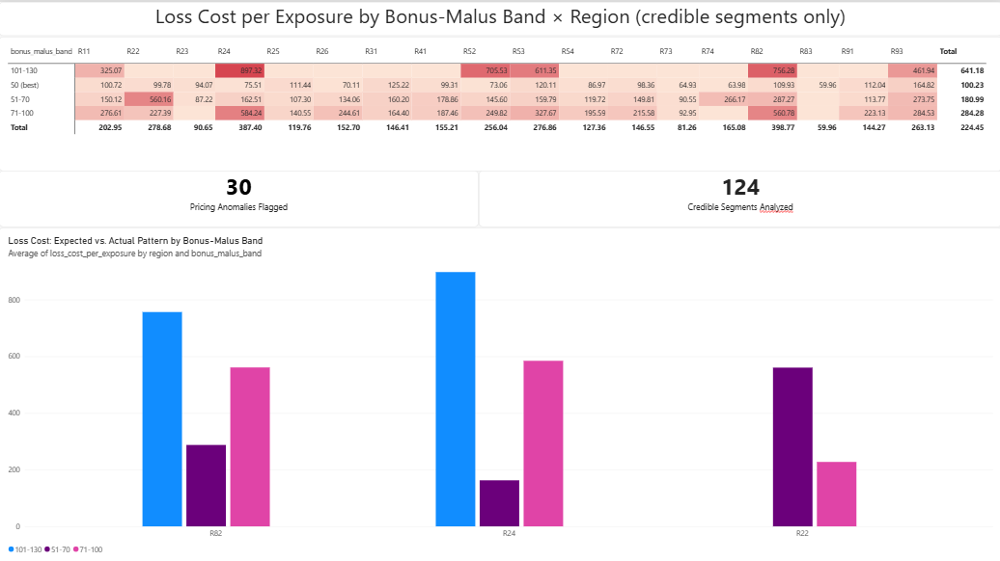
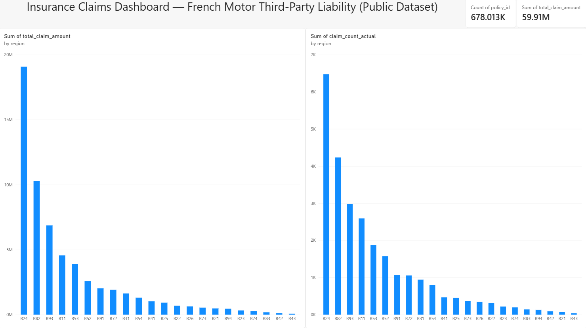

# Insurance Data Engineering Pipeline

Built an end-to-end insurance data pipeline using Python, PostgreSQL and dbt, transforming publicly available French motor third-party liability insurance data into tested, business-facing analytical marts, with Power BI dashboards on top.

## Overview

This project demonstrates a reproducible, modern data engineering workflow applied to real insurance data: raw files are ingested programmatically, loaded into a PostgreSQL warehouse, modeled through a layered dbt architecture (staging → intermediate → marts), validated with automated data-quality and business-logic tests, and surfaced through Power BI dashboards answering business questions.

## Architecture

```text
Public Insurance Data (OpenML / CASdatasets)
        ↓
   Python Ingestion
        ↓
     PostgreSQL
        ↓
        dbt
        ↓
     Staging
        ↓
   Intermediate
        ↓
       Marts
        ├── fct_policy_claims ──→ mart_risk_segment_loss_cost
        │
        └── fct_unmatched_policy_claims (exception records)
                    ↓
         Reconciliation across fact + exceptions
                    ↓
             Power BI dashboards
```

The policy fact contains claims whose policy IDs match the frequency dataset. Claims without a matching policy are retained separately in `fct_unmatched_policy_claims`, so they do not silently disappear from the pipeline.

## Dataset

**freMTPL2freq** and **freMTPL2sev** — French motor third-party liability insurance data, maintained in the [CASdatasets](https://github.com/dutangc/CASdatasets) project and retrieved programmatically via [OpenML](https://www.openml.org/) (dataset IDs 41214 and 41215).

- `freMTPL2freq`: 678,013 policies — risk characteristics (vehicle power/age, driver age, bonus-malus, region, etc.) and claim counts
- `freMTPL2sev`: 26,639 individual claims — claim amounts, linked to policies via `IDpol`

## Pipeline

1. **Ingestion** (`src/ingestion/download_data.py`) — pulls both datasets programmatically from OpenML; raw data is not committed to the repo, only the script that reproduces it.
2. **Loading** (`src/ingestion/load_to_postgres.py`) — loads raw CSVs into PostgreSQL as `raw_fremtpl2freq` and `raw_fremtpl2sev`.
3. **Transformation (dbt)**:
   - **Staging** — cleans and renames source columns, casts types (`stg_fremtpl2freq`, `stg_fremtpl2sev`).
   - **Intermediate** — aggregates claim-level data to policy level (`int_policy_claims_agg`).
   - **Marts** — creates the policy-level fact table (`fct_policy_claims`), the unmatched-claims exception model (`fct_unmatched_policy_claims`), and the risk-segment mart (`mart_risk_segment_loss_cost`).
4. **Testing**:
   - 5 dbt schema tests (`not_null`, `unique`) on key columns.
   - 1 custom business-logic test (`assert_bonus_malus_monotonic`, warning severity) checking whether loss cost rises monotonically with bonus-malus risk band. The current data flags 30 segment-pairs for investigation.
   - 1 referential-integrity test (`assert_claims_have_matching_policy`, warning severity) checking whether each severity claim maps to a policy. It currently flags six distinct policy IDs missing from the frequency dataset.
   - 1 reconciliation test (`assert_claim_amount_reconciles`) comparing the source claim count and total claim amount with the combined policy fact and exception model.
5. **Analytics** — Power BI dashboards connected to `fct_policy_claims` and `mart_risk_segment_loss_cost`.

## Business Questions Answered

- **Which rating-factor segments show loss cost inconsistent with their risk band?**

  Built a mart (`mart_risk_segment_loss_cost`) combining claim frequency and severity into a single loss-cost-per-exposure metric across bonus-malus × vehicle power × region. A custom dbt test checks whether loss cost rises monotonically with bonus-malus within each region, as the rating factor assumes.

- **Does it hold?**

  No — 30 segment-pairs break the expected pattern. The clearest case: region R22's mid-risk band (51–70) carries a higher loss cost (£560/exposure-unit) than the nominally worse band (71–100, £209–246). Regions R82 and R24 show similar ~35% breaks at higher bonus-malus tiers. These are candidates for re-pricing review, not definitive actuarial conclusions.

- **How much of the portfolio sits in segments too small to price reliably?**

  Segments with fewer than 30 claims are flagged `low credibility`. In this dataset, 14 of the 15 highest-loss-cost segments fall into that bucket — suggesting the riskiest-looking segments may be statistical noise rather than stable signal. This highlights the risk of overreacting to small samples in segment-level pricing.

## Dashboards

- **`dashboards/insurance_dashboard.pbix`** — the original descriptive view (claim cost and frequency by region).
- **`dashboards/risk_segmentation_dashboard.pbix`** — a heatmapped loss-cost matrix by bonus-malus band × region, KPI tiles for anomaly and credible-segment counts, and a comparison chart for three regions where the rating factor breaks down.



<details>
<summary>Original dashboard (claim cost/frequency by region)</summary>



</details>

## Data Quality Finding: Unmatched Claims

The referential-integrity check found six policy IDs in the severity dataset that are absent from the frequency dataset. Together, these account for **195 claim rows and 788,714.18 in claim amounts**.

The new `fct_unmatched_policy_claims` model retains those records for investigation. The reconciliation test compares the source severity data against both `fct_policy_claims` and `fct_unmatched_policy_claims`; locally, it passed with all 26,639 claims and the complete claim amount accounted for across those two outputs. The unmatched-policy check remains visible as a warning rather than treating known source-data discrepancies as resolved.

## Tech Stack

Python · pandas · SQLAlchemy · PostgreSQL · dbt · Power BI · Git/GitHub

## Project Status

- [x] **MVP1** — Data acquisition and PostgreSQL warehouse.
- [x] **MVP2** — dbt staging/intermediate/marts, five schema tests, a source-to-output reconciliation test, and documented data-quality exceptions.
- [x] **MVP3** — Power BI dashboards on business metrics.
- [x] **MVP4** — Risk-segment loss-cost analysis with a business-logic test flagging rating-factor anomalies.

## Data Limitations

This project uses publicly available historical French motor third-party liability insurance data. It contains no Deloitte, client, or policyholder data, and it is not representative of any real insurer's production scale, data volume, or latency requirements. The dbt layer covers key null/uniqueness checks, business-logic checks, referential integrity, and claim-count/amount reconciliation. The six unmatched policy IDs remain a documented source-data exception. A production pipeline would need further controls such as freshness checks, anomaly detection, orchestration (e.g. Airflow), monitoring, and an agreed operational process for exception handling.

## Why This Project

I have 4.5 years of enterprise insurance data experience from Deloitte, working with SAP HANA/CDS data models and IFRS17 reporting pipelines. For this portfolio project, I wanted to demonstrate how I'd apply modern data engineering practices — Python, PostgreSQL, dbt, automated testing, and a deeper analytical question (loss-cost adequacy by rating segment, not just claim counts) — to public insurance data. The project illustrates a layered, tested pipeline relevant to Data Engineer and Analytics Engineer roles.

## Reproducing This Project

```bash
git clone https://github.com/neha-nataraja/insurance-de-pipeline.git
cd insurance-de-pipeline
python -m venv .venv
.venv\Scripts\activate
pip install -r requirements.txt
python src/ingestion/download_data.py
# Create a .env file with your own PostgreSQL credentials.
python src/ingestion/load_to_postgres.py
cd insurance_dbt
dbt run
dbt test
```

`.env` format:

```text
DB_HOST=localhost
DB_PORT=5432
DB_NAME=insurance_pipeline
DB_USER=postgres
DB_PASSWORD=your_password
```
